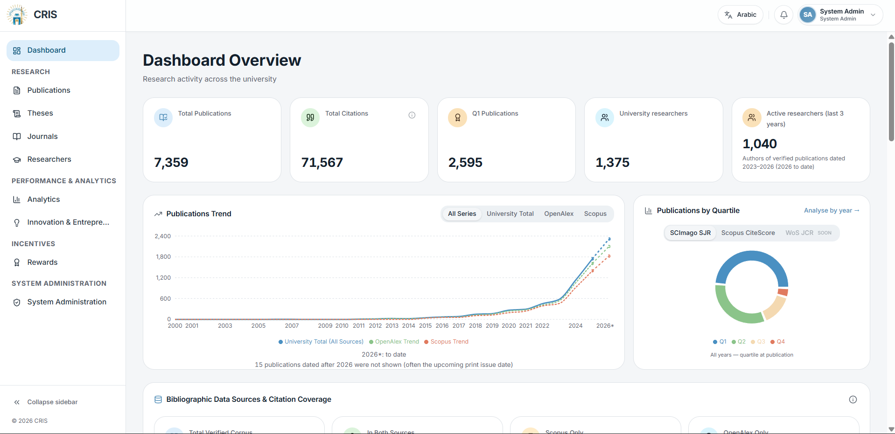
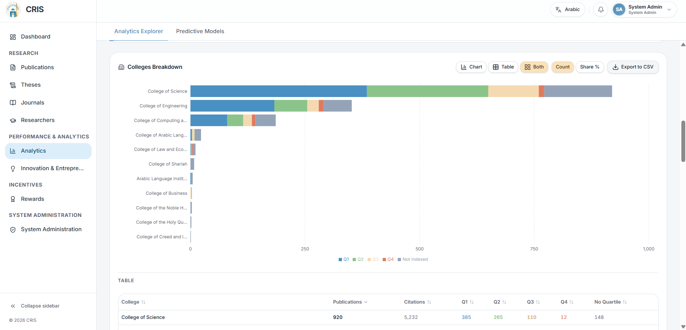

# Islamic University CRIS — Current Research Information System

[](https://iu-cris-system.vercel.app/)
[](https://iu-cris-system.vercel.app/)
[](#1-executive-dashboard--university-corpus)
[](#2-non-destructive-etl--citation-discrepancy)
[](#5-global-journal-discovery--arabicsharia-smart-matcher)
[](#system-architecture--technology-stack)

**Live Deployment:** [https://iu-cris-system.vercel.app/](https://iu-cris-system.vercel.app/)  
**Institution:** Islamic University of Madinah (Deanship of Scientific Research)  
**Architecture:** SSR Full-Stack Web Application · Automated Bibliometric ETL · Database-Enforced Governance  

> [!IMPORTANT]
> **Repository Scope & Institutional Confidentiality Notice**  
> This public repository hosts the architectural documentation and system showcase for our Computer Science graduation capstone project (**CRIS**). In accordance with institutional data governance, university server credentials, production seeds, and proprietary source code are kept private. You can explore the deployed portal directly at **[https://iu-cris-system.vercel.app/](https://iu-cris-system.vercel.app/)**.

---

## Where Does a University's Research Actually Live?

At the Islamic University of Madinah, scholarly output lived in several disconnected places at once: international bibliographic databases, internal college spreadsheets, and separate faculty portals—mostly reconciled by hand. The same publication could be counted twice or missed entirely, co-authorship across colleges was ambiguous, post-publication reward applications required repetitive manual verification, and leadership had no unified picture of institutional performance.

**Islamic University CRIS (Current Research Information System)** gives the university a single, verifiable system of record across its entire research lifecycle—from multi-source bibliographic ingestion and Arabic-aware journal discovery to statistical forecasting and zero-trust incentive processing.

We built it across three core engineering layers:

1. **Multi-Source API Collection:** Automated pipelines synchronizing publications, author profiles, and journal rankings across **Elsevier Scopus**, **Clarivate Web of Science (WoS)**, and **OpenAlex**, while explicitly accommodating Arabic and Sharia journals indexed in **ARCIF**.
2. **Non-Destructive ETL & Reconciliation:** Records are normalized, matched by DOI, and linked to university researchers, colleges, and departments—preserving per-source evidence rather than overwriting disagreements.
3. **Database-Governed SSR Web Platform:** Built with **React 19**, **TanStack Start**, **Nitro**, and **Supabase (PostgreSQL)**, featuring full bilingual support (**Arabic RTL / English LTR**) and **eight roles** enforced inside PostgreSQL Row-Level Security and `SECURITY DEFINER` RPCs.

---

## 1. Executive Dashboard & University Corpus



Rather than aggregating opaque numbers from a single vendor API, the Executive Overview aggregates verified institutional metrics side-by-side with full source attribution:

- **7,359 Verified Publications** across accredited indexes and non-indexed university scholarship (spanning 2000–2026*).
- **71,567 Reconciled Citations** tracked with cross-source transparency.
- **2,595 Q1 Publications** verified against historical publication-year rankings (not retroactively mutated by newer journal quartile updates).
- **1,375 Linked University Researchers**, including **1,040 active authors** across the 2023–2026 active window.
- **Interactive Series & Quartile Switchers:** Leadership can toggle trends dynamically across `All Series`, `University Total`, `OpenAlex`, and `Scopus`, and switch KPI and distribution views between **SCImago SJR** and **Scopus CiteScore** (with **WoS JCR** standby schema integrated).

---

## 2. Non-Destructive ETL & Citation Discrepancy

Bibliographic databases rarely agree on the exact same publication. Overwriting one API response with another silently corrupts audits and reward eligibility. Instead, CRIS maintains source-origin arrays (`sources text[]`), tracks provenance per integration in `source_api_keys`, and exposes variances openly to administrators.


In our live audit of the **150 top-cited publications indexed in both Scopus and OpenAlex**:
- **Only 21 papers (14.0%)** reported identical citation counts across both sources.
- **104 papers** recorded higher citation counts in **Scopus**.
- **25 papers** recorded higher citation counts in **OpenAlex** (driven by preprints and broader cross-publisher citation harvesting).

### Identity Resolution & Arabic Transliteration Normalization
Academic databases frequently fragment single scholars into multiple ghost profiles due to inconsistent Latin spellings (`Al-Zahrani` vs. `Alzahrany`, `Imran Shakir` vs. `Imran Shakyr`, `Ali` vs. `Aly`). Inside PostgreSQL, our custom `_researcher_name_norm()` function normalizes Arabic hamza/alif/taa-marbuta/yaa forms, unifies attached `al-`/`el-` prefixes, folds `i`/`y` transliteration variants, and pairs candidate duplicates using ORCID IDs, institutional affiliations, and shared college/department evidence—backing an interactive admin merge review queue with complete audit history.

---

## 3. Analytics Explorer & Multi-Level Drill-Downs


Decision-makers can slice publication velocity, citation density, Q1+Q2 share, active researcher participation, external collaboration rates, and dual-indexing coverage by year, source, college, or department. For example, examining the **2025 full-year snapshot** surfaces **1,743 publications**, **9,668 citations** (`5.55` average citations per paper), **662 Q1 papers** (`38.0%`), **59.6% Q1+Q2 share**, **93.2% external collaboration**, and a **71.3% dual-indexed rate**.



Hierarchical breakdowns span all university faculties—from **College of Science** (`920` publications / `5,232` citations / `385` Q1), **College of Engineering**, and **College of Computing and Information Systems** to specialized Arabic and Sharia colleges (**Arabic Language**, **Shariah**, **Noble Hadith**, **Holy Quran**, and **Creed & Da'wah**)—with stacked quartile charts, sortable summary tables (`Count` / `Share %`), and instant CSV exports.

---

## 4. Empirical Bayes Hierarchical Predictive Forecasting


Instead of fitting a naive linear projection or concealing extrapolations behind a black box, CRIS executes an **Empirical Bayes hierarchical forecasting model** (`train_forecast_models()`) directly inside PostgreSQL:

1. **Empirical Intra-Year Seasonal Pacing:** Naive `day-of-year / 365` scaling severely misestimates year-end output because publishing follows a steep Nov–Dec surge and many records carry January 1 unspecified-month dates. Our model excludes Jan 1 date artifacts and computes an empirical seasonal completion fraction across the prior **5 completed years**.
2. **Damped Log-Linear Growth Trend (`phi = 0.85`):** Trained across a **10-year historical window**, logarithmic trend damping prevents unrealistic exponential divergence while capturing institutional momentum (`R² = 0.98`, **41% annual growth rate**, projecting **2,642** works by end of 2026 from **2,314** YTD and **3,546** works in 2027).
3. **Hierarchical Coherence with Empirical Bayes Shrinkage:** Projects regularized shares down to **all 13 colleges and 29 academic departments**—avoiding arbitrary sample-size cutoffs that previously excluded smaller humanities departments—while explicitly displaying scientific caveats on index-coverage expansion effects.

---

## 5. Global Journal Discovery & Arabic/Sharia Smart Matcher


Faculty members and graduate students can search and evaluate **49,654 indexed journals** cataloged in `global_journals` with trigram (`pg_trgm`) and GIN indexing across **Scopus CiteScore (`CS`)**, **SCImago (`SJR`)**, **Web of Science (`JIF`)**, and **Open Access** signals:

- **Manuscript Smart Matcher:** Researchers paste a working paper title, abstract, or keywords freely without formatting rules and receive ranked venue matches filtered by target quartile (`Q1–Q4`), prior IU publication history (`IU Published Only`), Open Access status, and ranking year.
- **Dedicated Arabic & Sharia Classification Engine:** Many global catalogs misclassify Islamic Studies or Arabic Linguistics venues into generic categories—or leave Arabic researchers unserved. We engineered `normalize_arabic_text()` and `classify_journal_major_fields()` in PostgreSQL to strip Arabic diacritics/tatweel and prefixes, map cross-lingual terms (*Fiqh, Hadith, Shariah, Usul, Quranic Studies, Arabic Literature*), isolate pure STEM triggers from Sharia domains, and support an explicit **`Arabic & Theoretical Colleges`** mode (including **ARCIF** coverage).

---

## 6. Zero-Trust Academic Incentive & Reward Policy Engine


University incentive processing requires strict financial integrity. Client-submitted claims never determine payout formulas: **`incentive_quote()` runs as a server-side `SECURITY DEFINER` PostgreSQL function that ignores all client-supplied salary, nationality, quartile, author count, or monetary inputs**.

- **Dual Versioned Policies (`incentive_policies`):**
  - **Excellence Rewards:** Computes `verified basic salary × policy rate ÷ total authors` using HR-verified salary facts (`incentive_applicant_facts`), quartile rates (`Q1: 30%`, `Q2: 20%`, `Q3: 10%`), and nationality rules.
  - **Post-Publication Rewards:** Enforces fixed SAR tariffs aligned with institutional policy (`Nature / Science`, `Q1–Q4` tiers internal vs. external, `annual_limit: 3`), ASJC category similarity edges (`incentive_category_relations`), conflict-of-interest guards, and duplicate-claim unique constraints.
- **4-Stage Verified Approval Workflow:** Step-by-step researcher wizard (`Choose a paper` -> `Check eligibility` -> `Prepare & submit`) feeding an auditable review chain across **Department -> College -> Research Deanship -> Complete**, backed by `incentive_publication_facts` and immutable `incentive_events` audit trails.

---

## 7. Complete Institutional Ecosystem

Beyond publications and incentives, CRIS unifies neighboring workflows under one access-controlled workspace:

- **Graduate Theses Repository & Analytics (`/theses`):** End-to-end thesis lifecycle supporting Master's and PhD student submissions, duplicate detection, admin moderation queues with bilingual rejection feedback, public institutional catalog browsing, and scoped thesis analytics by department and college.
- **Innovation & Entrepreneurship Hub (`/innovation`, `/startups`):** Tracks institutional innovation projects alongside a startup registry enforcing quarterly follow-up schedules (with 14-day pre-close submission windows, overdue alerts, and 30-day post-submission edit locks) for the university entrepreneurship center.
- **Bahith Support & Publication Claiming (`/bahith`, `/publications-review`):** Streamlined DOI-validated publication requests and researcher funding requests with attachment handling and transparent status tracking.
- **Eight-Role Database Security Model (`app_role`):** Every route tab, RPC, and table policy enforces strict horizontal and vertical scoping across **8 PostgreSQL roles**:
  `Student` · `Faculty` · `DepartmentHead` · `CollegeDean` · `DeanOfScientificResearch` · `Auditor` · `Entrepreneurship` · `Admin`

---

## System Architecture & Technology Stack

```
┌────────────────────────────────────────────────────────────────────────────┐
│                   Bilingual SSR Frontend & Client Layer                    │
│     React 19 · TanStack Start · TanStack Router & Query · Vite 7 · Nitro   │
│         Tailwind CSS v4 · Radix UI · Recharts · Full AR (RTL) / EN (LTR)   │
└─────────────────────────────────────┬──────────────────────────────────────┘
                                      │ Authenticated RPCs / Row-Level Security
                                      ▼
┌────────────────────────────────────────────────────────────────────────────┐
│                PostgreSQL & Supabase Business Logic Core                   │
│   · 8-Role RBAC & SECURITY DEFINER RPCs (118+ Versioned SQL Migrations)    │
│   · Non-Destructive Multi-Source Staging & Identity Deduplication (pg_trgm)│
│   · Empirical Bayes Hierarchical Forecasting (train_forecast_models)       │
│   · Arabic-Aware Journal Recommender (49,654 Journals + ARCIF Support)     │
│   · Zero-Trust Versioned Incentive Policy Engine (incentive_quote)         │
└─────────────────────────────────────┬──────────────────────────────────────┘
                                      │ Scheduled Sync & API Telemetry
                                      ▼
┌────────────────────────────────────────────────────────────────────────────┐
│                      External Bibliographic Ecosystem                      │
│   Elsevier Scopus APIs · Clarivate Web of Science (WoS) · OpenAlex · ARCIF │
└────────────────────────────────────────────────────────────────────────────┘
```

| Layer | Technologies & Engineering Choices |
| :--- | :--- |
| **Framework & SSR Runtime** | React 19.2, TanStack Start, TanStack Router, Nitro, Vite 7, TypeScript 5.8 |
| **State & Data Layer** | TanStack React Query v5, React Hook Form, Zod, Supabase JS Client |
| **UI & Data Visualization** | Tailwind CSS v4, Radix UI Primitives, Recharts (Area, Scatter, Stacked Bar, Trend) |
| **Database & Core Logic** | Supabase / PostgreSQL (PL/pgSQL), Row-Level Security (RLS), `pg_trgm` GIN Indexing |
| **Bibliographic Integrations** | Elsevier Scopus REST API, OpenAlex API, Clarivate Web of Science (WoS), SCImago SJR, ARCIF |
| **Testing & Operations** | Unit suites (`navConfig`, journal relevance, duplicate matching, validation rules), SQL policy tests (`test_incentive_engine.sql`), GitHub Actions keep-alive pipeline |

---

## Acknowledgments & Credits

Whatever merit this work has, after God, belongs to our supervisor, **Prof. Dr. Ali bin Mousa Gharmallah Alzahrani**, Vice President for Graduate Studies and Scientific Research, and to our academic and technical advisor, **Dr. Oussama Benrhouma** — our sincere thanks to both for their guidance, trust, and continuous support.

Gratitude also goes to every member of our Computer Science graduation capstone team at the Islamic University of Madinah for building and refining this platform together.

**Author & Engineering Contact:**  
**Abdulqader Alshihabi** — Computer Science (Class of 2027) · Software & AI Engineer  
- Live Platform: [https://iu-cris-system.vercel.app/](https://iu-cris-system.vercel.app/)  
- Portfolio: [https://abdulqader-alshihabi.github.io/](https://abdulqader-alshihabi.github.io/)  
- GitHub: [@Abdulqader-Alshihabi](https://github.com/Abdulqader-Alshihabi)  
- Email: [abdulqader.moh.2003@gmail.com](mailto:abdulqader.moh.2003@gmail.com)
