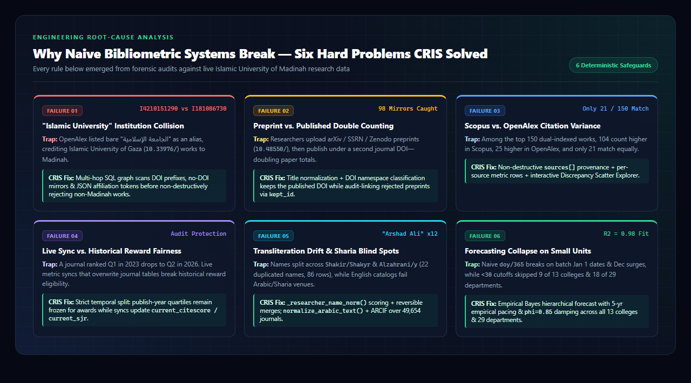
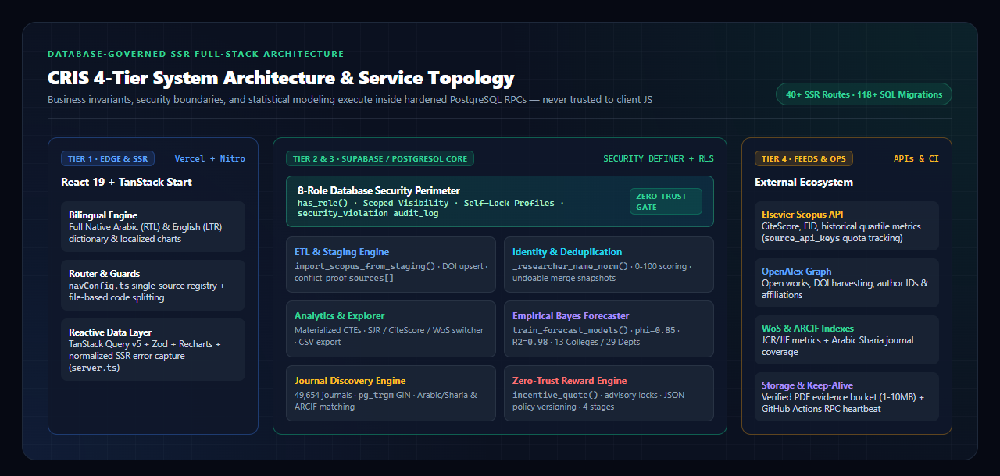
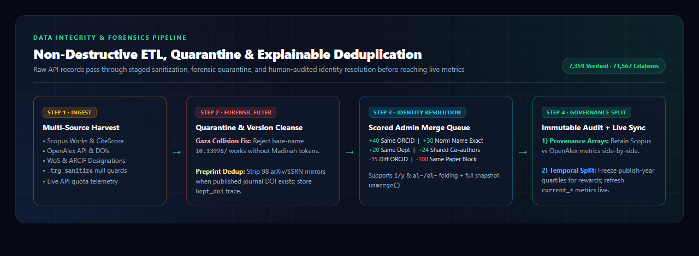
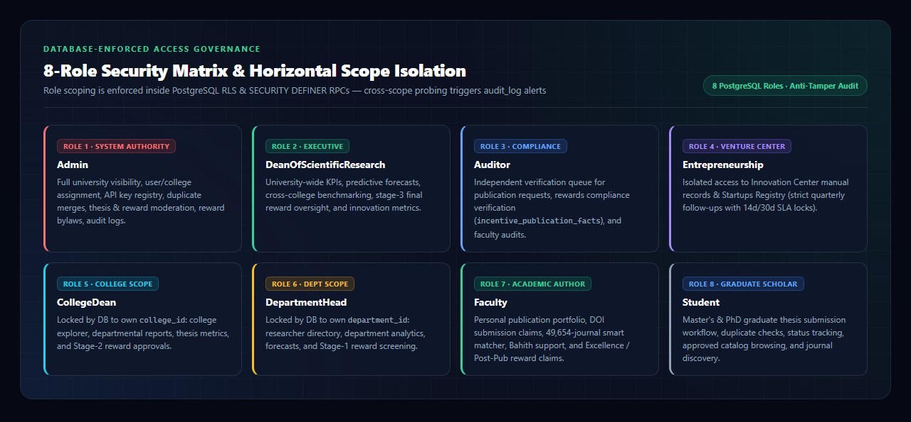
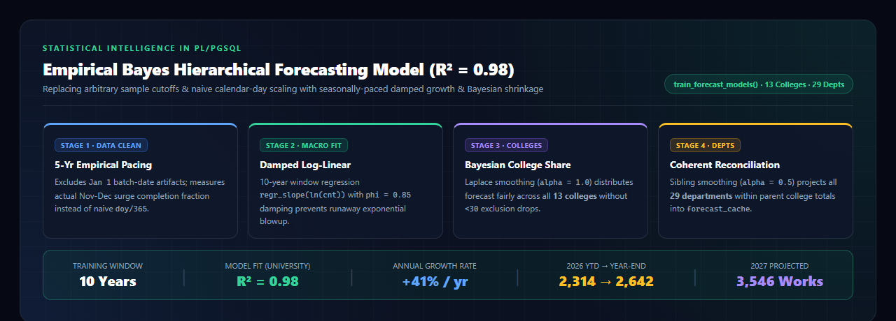
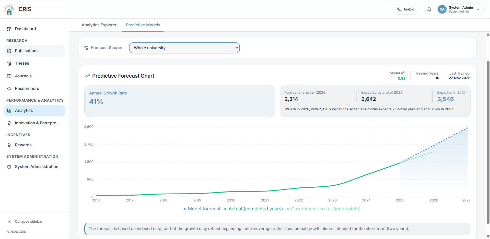
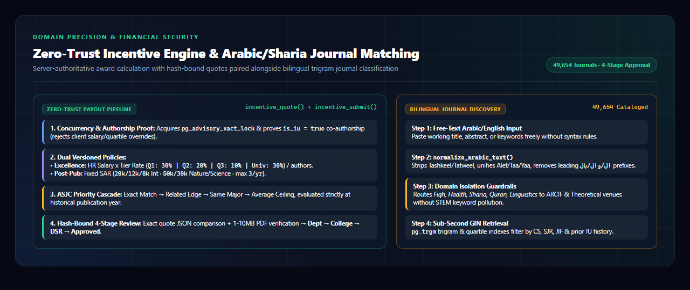
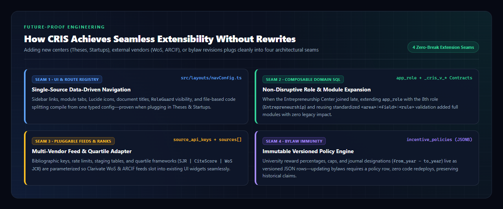

# Islamic University of Madinah — Current Research Information System (IU CRIS)

**One Verifiable Institutional Record Across Global Bibliometrics, Predictive Analytics, Bilingual Journal Intelligence, and Zero-Trust Research Incentives**

[Live Deployment](https://iu-cris-system.vercel.app/) &nbsp;|&nbsp; [Core Problems Solved](#where-does-a-universitys-research-actually-live) &nbsp;|&nbsp; [Architecture](#four-tier-system-architecture) &nbsp;|&nbsp; [ETL & Identity](#multi-source-etl--explainable-identity-resolution) &nbsp;|&nbsp; [Forecasting Math](#empirical-bayes-hierarchical-forecasting-model) &nbsp;|&nbsp; [Seamless Extensibility](#engineered-for-seamless-extensibility)

---

| Institutional Metric | Verified Baseline | Architectural Guarantee |
| :--- | :--- | :--- |
| **Verified Publications** | **7,359** works | Non-destructive deduplication & cross-institution isolation |
| **Documented Citations** | **71,567** citations | Per-source provenance preserved (OpenAlex, Scopus, WoS, ARCIF) |
| **Q1 Journal Output** | **2,595** Q1 papers | Historical publish-year rank frozen separately from live rank |
| **University Researchers** | **1,375** (`1,040` active) | Explainable `[0-100]` identity scoring & reversible snapshots |
| **Organizational Scope** | **13** Colleges / **29** Depts | Full drill-down from university leadership to individual researcher |
| **Global & Arabic Catalog** | **49,654** Journals | `pg_trgm` trigram GIN search + Sharia/Arabic domain isolation |
| **Predictive Model Accuracy** | **R² = 0.98** (`+41%/yr`) | 5-yr empirical pacing + damped log-linear trend + Bayes shrinkage |
| **Access & Finance Control** | **8** RBAC Roles | PostgreSQL RLS + `pg_advisory_xact_lock` + hash-bound reward quotes |

---

## Where Does a University's Research Actually Live?

At a growing university, research does not naturally live in one place. Before IU CRIS, publication records at the Islamic University of Madinah were scattered across global bibliographic databases and disconnected internal processes — entered manually across separate tools, counted twice when preprints and final versions coexisted, misattributed when institutions shared partial Arabic names, and re-verified by hand every time a researcher submitted an incentive claim. Leadership had no single auditable view of real research performance across colleges and departments.

**IU CRIS** transforms that fragmented reality into **one single, cryptographically auditable institutional source of truth**. Rather than trusting any single API blindly or relying on destructive data cleanup scripts, the platform separates **multi-source ingestion**, **forensic identity resolution**, **historical quartile governance**, **Bayesian predictive modeling**, and **server-authoritative financial approvals** into distinct, verifiable layers.

> [!IMPORTANT]
> **Engineering Philosophy — Preserve Evidence, Never Silently Overwrite:** When external providers disagree, IU CRIS refuses to discard conflicting records. Every excluded preprint, isolated foreign-institution paper, merged duplicate profile, and annual source metric retains an explicit audit trail (`kept_id`, `kept_doi`, `sources[]`, and merge snapshot history).

---

## Six Hard Real-World Problems — And How CRIS Solved Them Forensically

Most campus dashboards stop at charting clean demo CSVs. When ingesting real university data across **Scopus**, **OpenAlex**, **Web of Science**, and **ARCIF**, six severe structural failures emerged immediately — each requiring a dedicated algorithmic and database-level solution:

  

### Proof From Production Audits: The 86% Source Disagreement Rate

When auditing the **150 highest-cited papers** indexed in both Scopus and OpenAlex at the university, external databases disagreed dramatically on citation counts:

- **104 papers** reported higher citations in Scopus
- **25 papers** reported higher citations in OpenAlex
- Only **21 papers (14%)** matched identically across both sources

Because collapsing them into one column would permanently distort department evaluations or hide valid citations, IU CRIS retains an array-typed provenance column (`sources metric_source[]`) alongside side-by-side citation, cite-score, and quartile systems (`citescore_quartile()`, `quartiles_distribution_by_system()`).

  
  
<em>Production Citation Audit in IU CRIS: proving why multi-source provenance cannot be flattened into a single overwriteable counter.</em>

### How Every Forensic Problem Was Solved Without Data Loss

| Real-World Anomaly | Root Cause Discovered | Forensic Solution Engineered in CRIS | Verified Production Impact |
| :--- | :--- | :--- | :--- |
| **Institution Identity Collision** | Ambiguous Arabic alias `"الجامعة الإسلامية"` caused OpenAlex affiliation queries to pull papers from similarly named external universities (`I4210151290` using DOI prefix `10.33976/`). | Non-destructive multi-hop graph isolation (`S1 -> R -> S2`): identifies `10.33976/` anchor papers, resolves exclusive co-author cliques, and quarantines bare ambiguous strings lacking Madinah/Saudi tokens into an exclusion view. | Zero false foreign attribution while keeping `I181086730` clean without deleting underlying warehouse tables. |
| **Preprint Inflation** | ArXiv, SSRN, TechRxiv, Research Square, Zenodo, and OSF preprints appeared as separate counted papers alongside the published journal versions. | Regex DOI-family detector spanning 9 preprint servers (`2139/ssrn`, `36227/techrxiv`, `31219/osf.io`, `22541/au`, `20944/preprints`, `21203/rs`, `48550/arxiv`, `5281/zenodo`, `1101/`) suppresses duplicates while recording `kept_id` & `kept_doi`. | **98 duplicate preprints** surgically de-duplicated (`6,920 -> 6,822` verified records during baseline audit). |
| **Researcher Homonym & Transliteration Drift** | Common academic names (`"Arshad Ali"` appeared **12 times**) and Arabic-English transliteration variants (`y/i`, `al-/el-`) fragmented researcher portfolios. | Explainable weighted scorer (`[0..100]`) combines positive evidence (`+40` ORCID, `+30` exact name, `+20` dept, `+15` affiliation/transliteration, `+10` college, `+8/co-author`) against conflicts (`-100` same-paper co-author hard block) with reversible `unmerge_researchers()` snapshots. | Audited **22 duplicated name clusters** (**86** records across **1,375** researchers) with zero irreversible merges. |
| **Historical Reward vs. Live Rank Drift** | Updating live journal metrics mutated past publication quartiles (`Q1 -> Q2`), illegally altering historical reward eligibility. | Explicit separation between frozen publication-year rank columns (for financial bylaws) and live monitoring columns (`current_citescore_quartile`, `current_sjr_quartile`). | Guarantees bylaw fairness year-round even as live Scopus/CiteScore feeds sync continuously. |
| **Arabic & Sharia Retrieval Blindness** | Standard English keyword indexes strip diacritics poorly and contaminate Sharia/Fiqh searches with unrelated STEM journals. | Custom SQL pipeline `normalize_arabic_text()` strips Tashkeel/Tatweel & prefixes (`ال`/`وال`/`بال`), paired with `classify_journal_major_fields()` isolating Fiqh, Hadith, Sharia, Quran, and Arabic Linguistics toward ARCIF venues. | High-precision matching across all **13** theoretical and applied colleges alike. |

---

## Four-Tier System Architecture

Rather than placing heavy aggregation, security filtering, or financial math in client JavaScript where users can inspect, bypass, or desynchronize state, IU CRIS enforces a strict four-tier architecture linking **React 19 + TanStack Start SSR**, a **Single-Source Governance Registry**, a **PL/pgSQL Kernel**, and **Automated Multi-Source Ingestion**.

  

### Architectural Highlights

- **Bilingual SSR & Resilient Entry Shell (`src/server.ts` + TanStack Start + Nitro):** Server-side rendering eliminates cold white screens and normalizes swallowed HTTP 500 JSON responses through `normalizeCatastrophicSsrResponse` and `consumeLastCapturedError`, presenting contextual diagnostics across full English LTR and Arabic RTL layouts.
- **Database-Native Compute (`PL/pgSQL` RPCs):** Heavy matrix analytics (`analytics_explorer()` using `MATERIALIZED` CTEs), hierarchical forecasting (`train_forecast_models()`), trigram matching, and financial calculations run directly inside PostgreSQL next to the indexed rows — returning compact JSON payloads instead of streaming tens of thousands of records to the browser.
- **Mask-First API Governance (`source_api_keys`):** Bibliographic API credentials (Scopus, OpenAlex, WoS) are managed cleanly via masked RPCs (`get_source_api_keys()`), keeping secret keys off client state while giving administrators direct sync diagnostics and health telemetry via `.github/workflows/supabase-keep-alive.yml`.

  
  
<em>Executive Command Center: instant switching between SJR and CiteScore frameworks, verified researcher totals (1,375 total / 1,040 active), and full English/Arabic RTL support.</em>

---

## Multi-Source ETL & Explainable Identity Resolution

Data quality in CRIS is treated as a repeatable pipeline rather than a one-time spreadsheet import. Every record enters staging, undergoes provenance-preserving normalization, passes through explainable author disambiguation, and emerges as a unified institutional entity linked to college, department, quartile framework, and source array.

  

### Inside the Explainable Merge Scorer (`[0..100]`)

Unlike black-box clustering scripts that silently collapse distinct researchers, CRIS surfaces **every positive and negative point** behind a duplicate candidate review (`researcher_duplicates_review`):

- **Positive Evidence:** Same ORCID (`+40`), Exact Name (`+30`), Same Department (`+20`), Compatible Arabic/English Transliteration such as `y -> i` and `al-/el-` normalization (`+15`), Shared Affiliation (`+15`), Same College (`+10`), Shared Co-authors (`+8` per co-author, capped at `+24`).
- **Protective Penalties & Hard Blocks:** Conflicting ORCID (`-35`), Different College (`-25`), Middle-Name Initial Conflict (`-15`), and Co-authorship on the Same Paper (`-100` **hard block** — mathematically preventing a mentor/student or homonymous co-authors on one paper from ever merging).
- **Reversibility Guarantee:** Every executed merge persists pre-merge snapshots so `unmerge_researchers()` can cleanly restore split histories without broken foreign keys.

---

## Zero-Trust Security & 8-Role Governance

In an institutional system spanning **students**, **faculty**, **deans**, **auditors**, **innovation officers**, and **executive leadership**, UI-only route hiding is insufficient. IU CRIS compiles navigation visibility from a single TypeScript registry (`src/layouts/navConfig.ts`) AND enforces row-level authorization inside PostgreSQL itself across **8 distinct `app_role` tiers**.

  

- **Scoped Hierarchical Visibility:** A `DepartmentHead` or `CollegeDean` calling `analytics_explorer()` or reviewing incentive queues has their department/college boundaries enforced in SQL (`audit_log`-backed checks), while `DeanOfScientificResearch`, `Auditor`, and `Admin` hold full cross-university visibility.
- **Specialized Domain Isolation:** When the Entrepreneurship Center integrated into CRIS, the `Entrepreneurship` role gained scoped access to startup follow-up workflows (`14-day` open windows, `14-day` due tracking, `30-day` post-window edit locks) while strictly isolating sensitive academic HR and reward payroll views.

  
  
<em>College Performance Matrix across all 13 colleges (Science, Engineering, Computing, Arabic Language, Shariah, Holy Quran, Noble Hadith, Business, and more) with Chart/Table views and CSV export.</em>

---

## Empirical Bayes Hierarchical Forecasting Model

Standard dashboards commit two classic statistical blunders when forecasting annual research output: they either scale YTD numbers naively by `365 / day_of_year` (catastrophically over-predicting whenever Scopus/OpenAlex stamp bulk legacy works on `January 1`), or they run unregularized regressions per college and drop small units due to arbitrary `< 30` sample cutoffs.

To solve both problems rigorously inside PostgreSQL, IU CRIS implements `train_forecast_models()` — an **Empirical Bayes Hierarchical Model** spanning all **13 colleges** and **29 departments**:

  

### How the 4-Stage Pipeline Works

1. **Anomaly-Clean Empirical Pacing (5-Year Window):** Explicitly strips artificial `Jan 1` index-batch timestamps and measures each academic unit's *real empirical completion fraction* by day-of-year (capturing genuine Q4 November-December publication surges).
2. **Damped Log-Linear Macro Trend (10-Year Window):** Fits `regr_slope(ln(cnt))` over a full 10-year university trajectory with an exponential damping factor (`phi = 0.85`) — capturing compounding growth (`+41%/yr`) without runaway explosive extrapolation.
3. **Laplace-Smoothed College Share (`alpha = 1.0`):** Allocates the macro trajectory across all **13 colleges** using Bayesian shrinkage toward prior shares, eliminating `< 30` exclusion bias for theoretical and emerging faculties.
4. **Coherent Department Reconciliation (`alpha = 0.5` -> `forecast_cache`):** Projects all **29 departments** with sibling shrinkage constrained to sum coherently to their parent college totals, cached cleanly for sub-millisecond UI rendering.

  
  
<em>Granular KPI Scorecard: tracking Q1 share (38.0%), Q1+Q2 combined impact (59.6%), external collaboration (93.2%), and Scopus + OpenAlex dual-indexed coverage (71.3%).</em>

  
  
<em>Predictive Intelligence Screen: validated on 10 training years (R² = 0.98), tracking +41% annual growth from 2,314 YTD to 2,642 end-2026 and 3,546 projected works in 2027.</em>

---

## Bilingual Journal Intelligence & Zero-Trust Incentive Engine

Research governance extends beyond retrospective analytics into two high-stakes faculty workflows: **finding the right accredited venue before submission** and **calculating financial publication rewards transparently without tampering or concurrency bugs**.

  

### 1. Manuscript Smart Matcher (`49,654` Indexed Venues)

Faculty members paste a working title, abstract, or keywords in either **Arabic** or **English**. Under the hood, CRIS runs `normalize_arabic_text()`, enforces **Sharia/Arabic Domain Isolation Guardrails** (`classify_journal_major_fields()`) so *Fiqh*, *Hadith*, *Quranic Studies*, and *Arabic Linguistics* manuscripts match ARCIF & theoretical outlets cleanly, and ranks results over `pg_trgm` GIN trigram indexes (`global_journals`) with instant filters for `CS`, `SJR`, `JIF`, quartile tier (`Q1-Q4`), `Open Access`, and `IU Published Only` precedent.

  
  
<em>Journal Recommender & Smart Matcher across 49,654 global & Arabic journals with SJR, CiteScore, JIF, Open Access, and IU publishing history filters.</em>

### 2. Zero-Trust Financial Reward Workflow (`incentive_quote()` -> 4-Stage Audit)

Because research incentives represent direct university budget disbursements, **no salary figure, quartile multiplier, co-author split, or payout cap is ever trusted from the browser**:

- **Concurrency & Co-Authorship Proof:** Calling `incentive_quote()` acquires a PostgreSQL transaction advisory lock (`pg_advisory_xact_lock`) and verifies genuine `is_iu = true` co-authorship inside the database.
- **Dual Versioned Policies (`incentive_policies`):** Evaluates either **Excellence Allowance** (HR Salary x Tier Rate: `Q1 30%`, `Q2 20%`, `Q3 10%`, `University Venue 30%`, prorated across authors) or **Post-Publication Reward** (Fixed SAR caps: `20k/12k/8k` International, `50k/30k` Nature/Science tier, capped at `3` claims/year).
- **ASJC Priority Cascade:** Resolves journal quartile using `Exact Match -> Related Edge -> Same Major -> Average Ceiling`, evaluated strictly against the paper's **historical publication year**.
- **Hash-Bound Submission & 4-Stage Review:** On final submission, the database recomputes the exact payout (`p_expected_calculation`), validates an uploaded PDF proof in the `incentive-evidence` bucket, and routes the claim sequentially through `Department -> College -> Deanship of Scientific Research (DSR) -> Approved`.

  
  
<em>Incentive Claims Engine: clear side-by-side policy eligibility rules feeding into a server-locked 3-step submission & 4-stage administrative approval chain.</em>

---

## Engineered for Seamless Extensibility

Graduation projects often collapse the moment a new college, external API, or policy rule arrives late in the semester. When **Theses Management** and the **Entrepreneurship & Startup Follow-Up Center** joined IU CRIS well into development, we deliberately engineered four architectural seams so new institutional pillars plug in cleanly **without touching or destabilizing legacy modules**:

  

### The Four Extension Seams in Practice

1. **Single-Source Typed Navigation & Guard Registry (`src/layouts/navConfig.ts`):** Sidebar groups (`NAV_GROUPS`: `research`, `analytics`, `rewards`, `administration`), module tabs (`NAV_MODULES`), Lucide icons, document titles, and `RoleGuard` permissions compile from one strongly typed registry. Adding *Theses* or *Entrepreneurship* required declaring one module entry and role list — zero duplicated header/sidebar conditionals.
2. **Composable Domain SQL & Uniform Error Contracts (`_cris_fail` / `_cris_v_*`):** Every new domain migration shares standardized PostgreSQL validation helpers emitting deterministic `<area>:<field>:<rule>` error contracts, while PostgreSQL's `app_role` enum extended cleanly to add `'Entrepreneurship'` as the 8th role without mutating existing `Faculty`, `Dean`, or `Auditor` policies.
3. **Pluggable Bibliographic Feed & Quartile Adapters:** Credentials (`source_api_keys`), provenance arrays (`sources metric_source[]`), and quartile calculators (`citescore_quartile()`, `quartiles_distribution_by_system()`) treat evaluation frameworks as first-class variants (`SJR`, `CiteScore`, `WoS`, `ARCIF`) so new Clarivate Web of Science or regional feeds slot straight into existing analytics cards.
4. **Immutable Versioned Bylaw Engine (`incentive_policies` JSONB):** University financial percentages, caps, and special-tier titles (`from_year - to_year`) live in versioned database rows rather than compiled TypeScript constants — changing next year's bylaw requires inserting one policy row with zero code redeploy and complete protection for past claims.

---

## Security & Scope Note on This Repository

> [!NOTE]
> Per institutional deployment and academic governance policy, private production source code and database credentials are intentionally excluded from this public repository. This flagship repository preserves the complete engineering documentation, live interactive portal access ([iu-cris-system.vercel.app](https://iu-cris-system.vercel.app/)), verified architectural diagrams, and production system screenshots.

---

## Acknowledgments

Whatever merit this work has, after God, belongs first to our supervisor **Prof. Dr. Ali bin Mousa Gharmallah Alzahrani**, Vice President for Graduate Studies and Scientific Research at the Islamic University of Madinah, for his vision, guidance, and trust — and to our academic and technical advisor **Dr. Oussama Benrhouma** for his continuous mentorship and rigorous engineering standards. Our sincere gratitude to both, and to my Computer Science graduation capstone teammates who shared every step of building IU CRIS from concept to production reality.

---

**Built with precision for the Islamic University of Madinah**

[Open Live Portal (iu-cris-system.vercel.app)](https://iu-cris-system.vercel.app/) &nbsp;|&nbsp; Built by **Abdulqader Alshihabi** & Capstone Team

