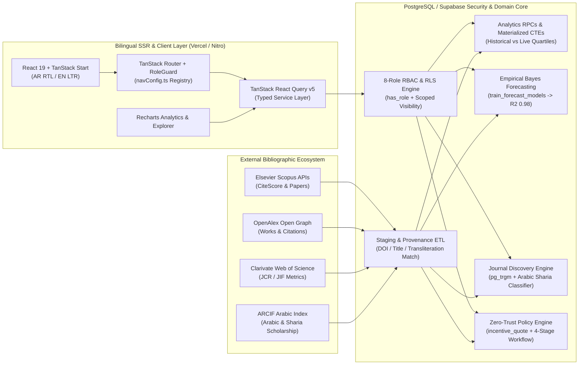
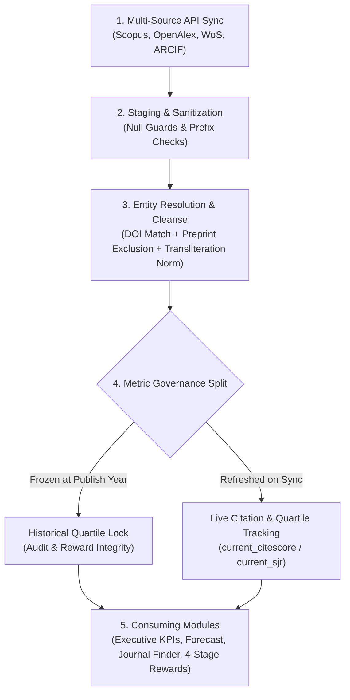
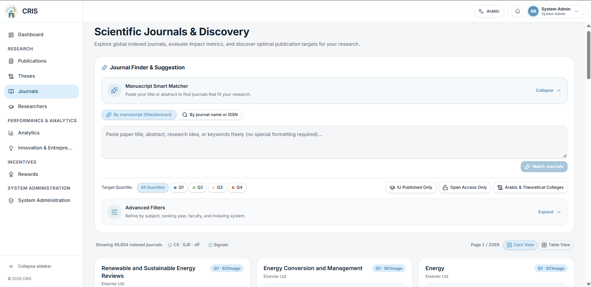
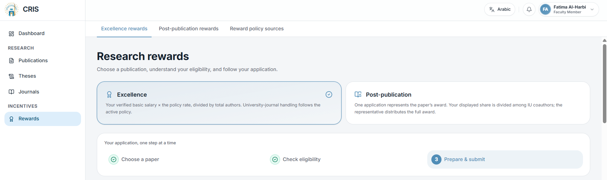

# Islamic University CRIS — Current Research Information System

**Live Production System:** [https://iu-cris-system.vercel.app/](https://iu-cris-system.vercel.app/)  
**Institution:** Islamic University of Madinah — Deanship of Scientific Research  
**Domain:** Enterprise Bibliometrics · Automated ETL · Statistical Forecasting · Zero-Trust Incentive Governance  

> [!IMPORTANT]
> **Repository Scope & Institutional Governance Notice**  
> This repository serves as the technical case study and architectural showcase for the **Islamic University CRIS** graduation capstone project. In compliance with institutional data protection and university infrastructure policies, private credentials, database seeds, and application source files remain in a private repository. The live deployed portal is accessible at **[https://iu-cris-system.vercel.app/](https://iu-cris-system.vercel.app/)**.

---

## 1. The Core Problem — Why Building a University CRIS Is Hard

Where does a university's research actually live?

At the Islamic University of Madinah, it lived across multiple places at once: international bibliographic APIs, isolated college spreadsheets, and separate manual portals. A single paper could be counted twice or missing altogether, authorship links across faculties were unclear, reward claims required repeated manual verification, and executive leadership had no unified view of institutional research performance.

Building an institutional **Current Research Information System (CRIS)** is not a simple CRUD dashboard over one external API. When unifying real bibliographic data across **Elsevier Scopus**, **Clarivate Web of Science (WoS)**, **OpenAlex**, and Arabic journals indexed in **ARCIF**, we uncovered six non-trivial engineering failures that break naive implementations:

| Real-World Data Failure | Why Naive Solutions Break | How CRIS Solved It Deterministically |
| :--- | :--- | :--- |
| **1. "Islamic University" Institution Collision** | OpenAlex listed bare `"الجامعة الإسلامية"` as an alias, attributing papers by the *Islamic University of Gaza* (`10.33976/` DOIs) to *Islamic University of Madinah* and spawning ghost researcher profiles. | Multi-hop SQL forensic graph linking DOI prefixes, no-DOI translations, and JSON affiliation tokens (verifying absence of Madinah/Saudi indicators) to reject misattributions non-destructively without touching valid faculty papers. |
| **2. Preprint vs. Journal Double Counting** | Researchers post arXiv/SSRN/Zenodo preprints (`10.48550/`, `10.2139/`) months before publishing in peer-reviewed journals under a new DOI—inflating publication totals and skewing growth trends. | Title normalization + DOI namespace classification within a 2-year publish window: automatically prefers the peer-reviewed journal DOI while preserving non-destructive audit links (`kept_id`, `kept_doi`) on excluded preprint mirrors. |
| **3. Source Disagreement on Citations** | External indexes rarely agree on citation counts. Blindly overwriting records on sync erases evidence and breaks audits. Among our **150 top-cited dual-indexed works**, only **21 (14%)** matched between Scopus and OpenAlex (**104** higher in Scopus; **25** higher in OpenAlex). | Per-source provenance arrays (`sources text[]`), partitioned metric histories, and an explicit **Citation Discrepancy Explorer** allowing leadership to inspect index divergence instead of hiding it. |
| **4. Live Sync vs. Historical Audit Paradox** | A journal ranked `Q1` in 2023 might drop to `Q2` in 2026. If live API syncs mutate a paper's historical rank, eligible faculty retroactively lose earned rewards or audits fail. | Explicit structural separation in PostgreSQL: **publication-year quartiles remain frozen** for legal reward compliance while live syncs update separate `current_citescore_quartile`, `current_sjr_quartile`, and timestamp columns. |
| **5. Arabic Transliteration Drift & Non-STEM Blind Spots** | Scholars appear across databases as `Al-Zahrani` / `Alzahrany` or `Imran Shakir` / `Imran Shakyr`, splitting profiles. Meanwhile, Arabic/Sharia journals (*Fiqh, Hadith, Quran*) are routinely misclassified or ignored by English-only STEM catalogs. | `_researcher_name_norm()` folds Arabic letters (`أإآ -> ا`, `ى -> ي`, `ة -> ه`), splits attached `al-/el-` prefixes, and unifies `i`/`y` variants alongside ORCID/department scoring. For journals, `normalize_arabic_text()` and `classify_journal_major_fields()` isolate Arabic/Sharia semantics across **49,654 journals** and support **ARCIF**. |
| **6. Forecasting Collapse on Small Colleges** | Simple `day-of-year / 365` extrapolations fail due to batch Jan 1 publication dates and year-end publishing surges, while arbitrary `< 30` sample cutoffs previously dropped **9 of 13 colleges** and **18 of 29 departments**. | **Empirical Bayes Hierarchical Model** inside PostgreSQL: computes 5-year empirical intra-year seasonality (excluding Jan 1 artifacts), applies damped log-linear trend scaling (`phi = 0.85`), and shrinks shares down to every college and department (`R² = 0.98`). |

---

## 2. System Architecture

CRIS follows a **Database-Governed SSR Full-Stack Architecture**. Rather than scattering business rules, role checks, and reward math across frontend hooks, critical domain invariants live inside PostgreSQL (`SECURITY DEFINER` RPCs, triggers, and Row-Level Security policies) while the **React 19 + TanStack Start + Nitro** layer delivers a responsive, type-safe bilingual experience (`Arabic RTL / English LTR`).

### Why Database-First Domain Governance?
1. **Zero-Trust Incentive & Scope Enforcement (`SECURITY DEFINER` + RLS):** Client applications never pass salary figures, quartile eligibility, nationality flags, department scopes, or payout amounts. Every privileged computation executes inside hardened SQL RPCs (`incentive_quote()`, `analytics_explorer()`, `theses_analytics()`) that verify `auth.uid()` roles directly against PostgreSQL tables and log security violations automatically in `audit_log`.
2. **Non-Destructive ETL Pipeline Architecture:** External feeds enter isolated staging tables first (`openalex_staging`, `scopus_works_staging`, `scopus_authors_staging`), pass through conflict-proof upsert procedures with source provenance (`sources text[]`), and log API quota telemetry in `source_api_keys` before exposing verified works to institutional views.
3. **Full SSR + Edge Readiness:** **TanStack Start** paired with **Nitro**, **Vite 7**, and **Tailwind CSS v4** provides clean SSR routing, normalized server error capture (`src/server.ts`), client telemetry isolation, and automatic route-level code splitting across **40+ specialized pages**.

---

## 3. Platform Showcase & Verified Capabilities

### 1) Executive Command Center & University Corpus

The unified executive view surfaces verified university output alongside full source and ranking attribution:
- **7,359 Verified Scientific Publications** across accredited global indexes and institutional scholarship (spanning 2000–2026*).
- **71,567 Documented Citations** reconciled across sources.
- **2,595 Q1 Publications** computed strictly against publication-year quartile standings.
- **1,375 University Researchers**, highlighting **1,040 active authors** (2023–2026).
- Live controls to isolate trends (`All Series`, `University Total`, `OpenAlex`, `Scopus`) and toggle ranking frameworks (`SCImago SJR`, `Scopus CiteScore`, and standby `WoS JCR`).

---

### 2) Non-Destructive ETL & Citation Discrepancy Audit

Instead of picking a single arbitrary citation number, CRIS plots citation variance transparently across dual-indexed literature:
- Across the **150 highest-cited shared publications** in Scopus and OpenAlex, only **21 (14.0%)** report equal counts.
- **104** report higher counts in **Scopus**, while **25** count higher in **OpenAlex** (preprints and cross-publisher links).
- Paired with an administrative **Researcher Identity Audit & Duplicate Queue** scoring matches on normalized Arabic-English transliteration, shared college/department, ORCID, and affiliation evidence with reversible group merges.

---

### 3) Analytics Explorer & Faculty Drill-Downs

Leadership can filter institutional velocity, average citations per paper, `Q1+Q2` ratio, active faculty density, external collaboration rate, and dual-indexed coverage across custom year spans and scopes (e.g., the **2025 benchmark view**: `1,743` papers, `9,668` citations, `5.55` avg. citations, `662` Q1 works, `59.6%` Q1+Q2 share, `93.2%` external collaboration, `71.3%` dual-indexed rate).

Side-by-side college and department rankings compare STEM faculties (**College of Science**: `920` publications / `5,232` citations / `385` Q1, **College of Engineering**, **College of Computing and Information Systems**) alongside **Arabic Language**, **Shariah**, **Law & Economics**, **Noble Hadith**, **Holy Quran**, and **Creed & Da'wah**, complete with `Chart | Table | Both` modes, `Count | Share %` toggles, and one-click CSV export.

---

### 4) Empirical Bayes Hierarchical Predictive Model

Executed in PostgreSQL via `train_forecast_models()`, the statistical engine models short-term two-year output with complete scientific transparency:
- Accounts for Nov–Dec publishing acceleration via **5-year empirical seasonal pacing** rather than naive calendar-day ratios.
- Applies **damped log-linear projection (`phi = 0.85`)** across a **10-year training window**, achieving **`R² = 0.98`** university-wide (**41% annual growth**, projecting **2,642** publications by year-end 2026 from **2,314** YTD and **3,546** in 2027).
- Forecasts remain hierarchically consistent down to every college and department, clearly annotating caveats where index-coverage expansion influences historical slopes.

---

### 5) Global Journal Discovery & Arabic/Sharia Intelligence

Housing **49,654 global journals** indexed with `pg_trgm` trigram and GIN indexes across `CS` (CiteScore), `SJR`, `JIF` (Web of Science), and Open Access signals:
- **Manuscript Smart Matcher:** Researchers paste an unformatted working title, abstract, or keywords to discover optimal target venues ranked by relevance, prior university publishing track record (`IU Published Only`), Open Access status, and quartile tier (`Q1–Q4`).
- **Bilingual Arabic & Sharia Matching:** Built-in PostgreSQL text normalizers and cross-lingual topic classifiers accurately route researchers from theoretical and Sharia faculties to peer-reviewed venues—including dedicated **`Arabic & Theoretical Colleges`** and **ARCIF** support without STEM contamination.

---

### 6) Zero-Trust Academic Rewards & Multi-Stage Review

Built around `incentive_quote()` and versioned `incentive_policies`:
- **Excellence Track:** Calculates `verified basic salary x policy rate / authors` across `ESCI` and `University` tiers (`Q1: 30%`, `Q2: 20%`, `Q3: 10%`) strictly from HR-verified facts (`incentive_applicant_facts`).
- **Post-Publication Track:** Applies institutional SAR reward tariffs (up to `50,000 SAR` internal / `30,000 SAR` external, capped at `annual_limit: 3`), ASJC category similarity edges (`incentive_category_relations`), co-author link validation, and conflict-of-interest guards.
- **4-Stage Audit Chain:** Guided 3-step submission flow feeding sequential review (`department -> college -> research -> complete`) with immutable event logging (`incentive_events`).

---

### 7) Unified Institutional Workflows
- **Graduate Theses Repository (`/theses`):** End-to-end submission, duplicate checks, admin moderation with bilingual rejection feedback, public catalog browsing, and scoped analytics across colleges/departments.
- **Innovation & Startups Center (`/innovation`, `/startups`):** Tracks university patents/innovations alongside structured startup registration and strict sequential **quarterly follow-ups** (14-day pre-close windows, due/overdue alerts, and 30-day post-submission edit locks).
- **Bahith Support & Publication Requests (`/bahith`, `/publications-review`):** Self-service DOI-validated publication claims and research support requests with verified audit trails.

---

## 4. How We Engineered Seamless Scalability & Extensibility

As a graduation project serving an active university environment, CRIS needed to grow without architectural rewrites as new colleges, external APIs, reward policies, and organizational centers came online. Five deliberate design decisions made expansion seamless:

1. **Single-Source Registry for UI & Access Control (`src/layouts/navConfig.ts`):**
   Every sidebar module, sub-tab, icon, route prefix, and allowed role set is declared in a single typed configuration (`NAV_MODULES` & `NAV_GROUPS`), consumed dynamically by layout navigation, document titles, `RoleGuard`, and automated unit tests (`navConfig.test.ts`). Plugging in a brand-new module only requires registering one entry and adding a file-based TanStack Start route (`src/routeTree.gen.ts`).
2. **Non-Disruptive Domain & Role Expansion (`app_role` + Shared Contracts):**
   When the **Innovation & Entrepreneurship Center** and **Graduate Theses** domains were added late in the project lifecycle (migrations `0061`–`0063`), we appended an 8th value (`Entrepreneurship`) to `public.app_role`, reused shared PostgreSQL validation primitives (`_cris_fail`, `_cris_v_*` standardized `<area>:<field>:<rule>` error contracts), and isolated all access behind `SECURITY DEFINER` RPCs—zero regressions to existing publication or reward workflows.
3. **Pluggable Bibliographic Sources & Ranking Systems:**
   External API integrations live inside a generic `source_api_keys` telemetry registry coupled with isolated staging schemas and array-based provenance (`publications.sources`). Analytical views and explorer RPCs parameterize the ranking system (`SJR`, `CiteScore`, `WoS JCR`). Onboarding **Clarivate Web of Science** or expanding **ARCIF** feeds requires adding a feed worker without rewriting UI charts or breaking historical queries.
4. **Versioned Immutable JSON Reward Policies (`incentive_policies`):**
   University reward tariffs and eligibility rules change regularly. Instead of hardcoding formulas in TypeScript—which would corrupt historical applications whenever bylaws change—policies live as versioned JSON configs (`reward_type, version, config`) paired with date-bounded `incentive_journal_designations` (`from_year`–`to_year`). Every submitted claim remains permanently pinned to its issuing `policy_id`.
5. **Corpus & Compute Scaling Inside PostgreSQL:**
   Trigram (`pg_trgm`) + array GIN indexes keep full-text and bilingual discovery sub-second across **49,654 journals**; `MATERIALIZED` CTE blocks prevent redundant scans inside multi-chart explorer payloads; `forecast_cache` eliminates runtime regression overhead; and Empirical Bayes shrinkage guarantees statistical forecasts scale automatically whenever new departments or colleges are created.

---

## 5. System Role Matrix & Engineering Stack

Access across all **40+ routes** and PostgreSQL tables runs through **eight roles** enforced in the database itself:
`Student` · `Faculty` · `DepartmentHead` · `CollegeDean` · `DeanOfScientificResearch` · `Auditor` · `Entrepreneurship` · `Admin`

| Layer | Technologies & Architectural Choices |
| :--- | :--- |
| **SSR & Routing Framework** | React 19.2, TanStack Start, TanStack Router, Nitro, Vite 7, TypeScript 5.8 |
| **Data Fetching & Validation** | TanStack React Query v5, React Hook Form, Zod, Shared SQL `<area>:<field>:<rule>` Contracts |
| **UI System & Visualization** | Tailwind CSS v4, Radix UI Primitives, Recharts (Area, Trend, Scatter, Stacked Quartiles), AR RTL / EN LTR |
| **Database & Business Logic** | Supabase / PostgreSQL (118+ SQL Migrations), PL/pgSQL `SECURITY DEFINER` RPCs, Row-Level Security, `pg_trgm` GIN |
| **External Integrations** | Elsevier Scopus APIs, OpenAlex API, Clarivate Web of Science (WoS), SCImago SJR, ARCIF |
| **Verification & Operations** | Vitest/unit suites (`navConfig`, journal relevance, duplicate matching, validation rules), SQL test harnesses (`test_incentive_engine.sql`), GitHub Actions keep-alive telemetry |

---

## Acknowledgments & Credits

Whatever merit this work has, after God, belongs to our supervisor, **Prof. Dr. Ali bin Mousa Gharmallah Alzahrani**, Vice President for Graduate Studies and Scientific Research, and to our academic and technical advisor, **Dr. Oussama Benrhouma** — our sincere thanks to both for their mentorship, trust, and guidance throughout this project.

Deep appreciation also goes to every companion and teammate on our Computer Science graduation project team at the Islamic University of Madinah for sharing the engineering journey from first API experiments to production launch.

**Author & Engineering Contact:**  
**Abdulqader Alshihabi** — Software & AI Engineer · Computer Science (Class of 2027)  
- Live Platform: [https://iu-cris-system.vercel.app/](https://iu-cris-system.vercel.app/)  
- Portfolio: [https://abdulqader-alshihabi.github.io/](https://abdulqader-alshihabi.github.io/)  
- GitHub: [@Abdulqader-Alshihabi](https://github.com/Abdulqader-Alshihabi)  
- Email: [abdulqader.moh.2003@gmail.com](mailto:abdulqader.moh.2003@gmail.com)
