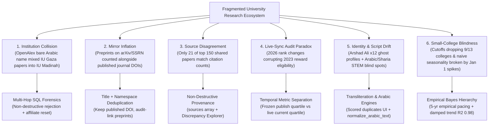
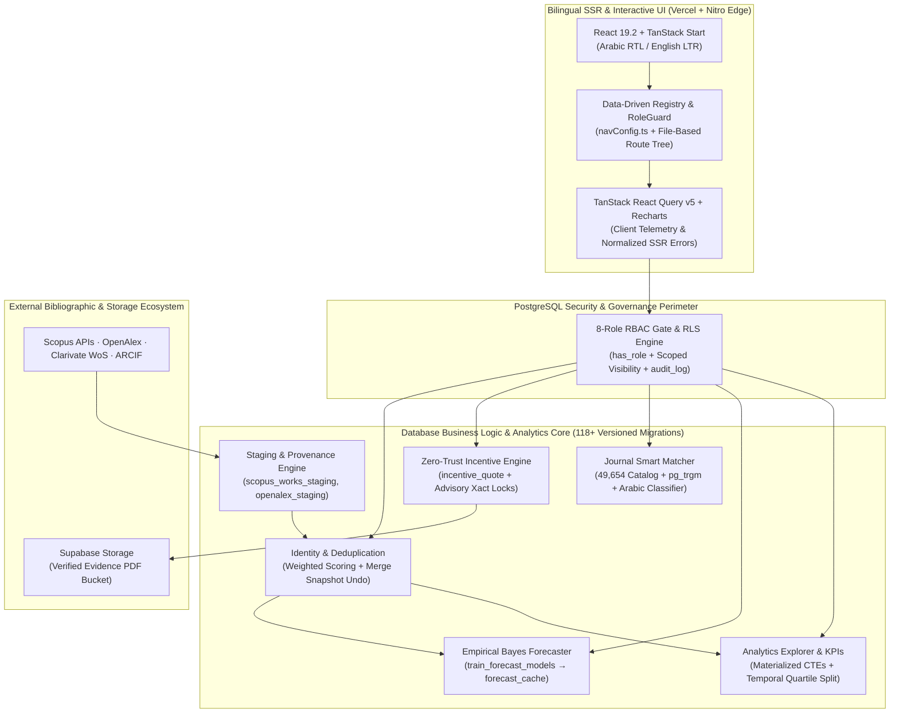
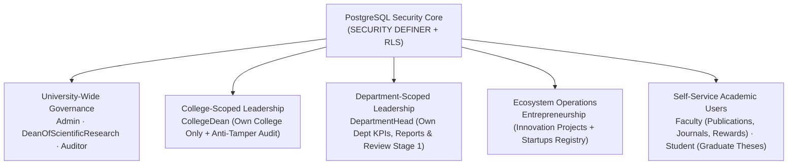
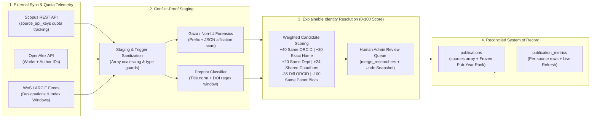
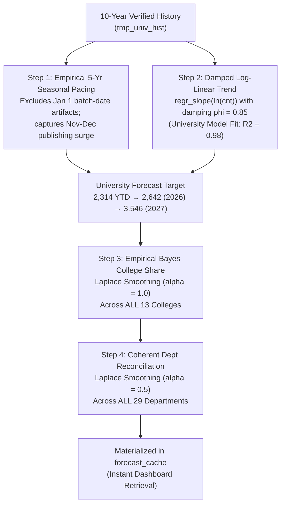
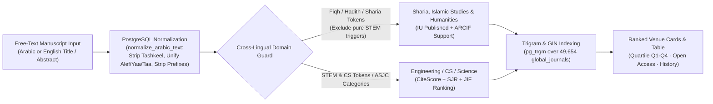
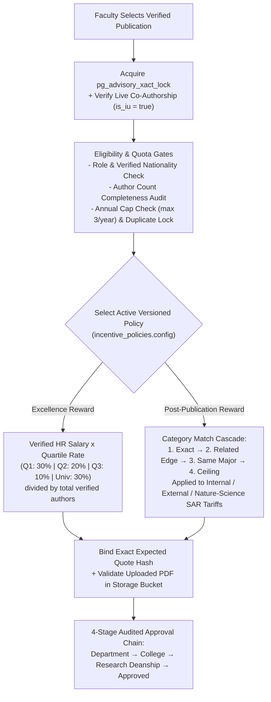
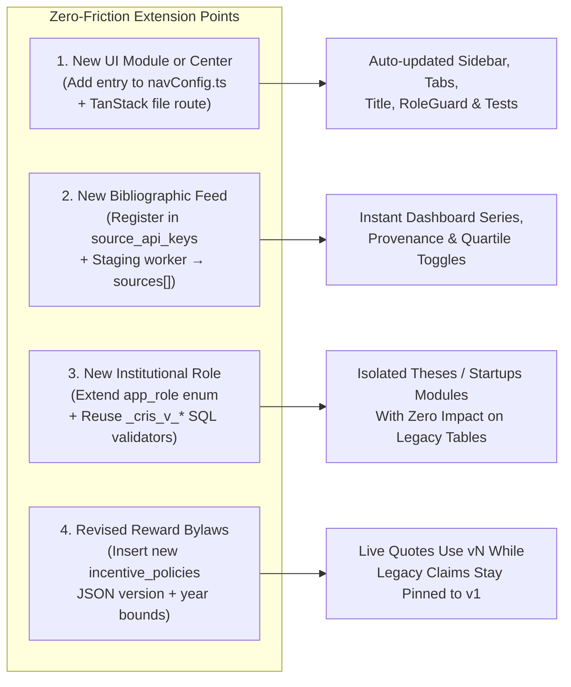
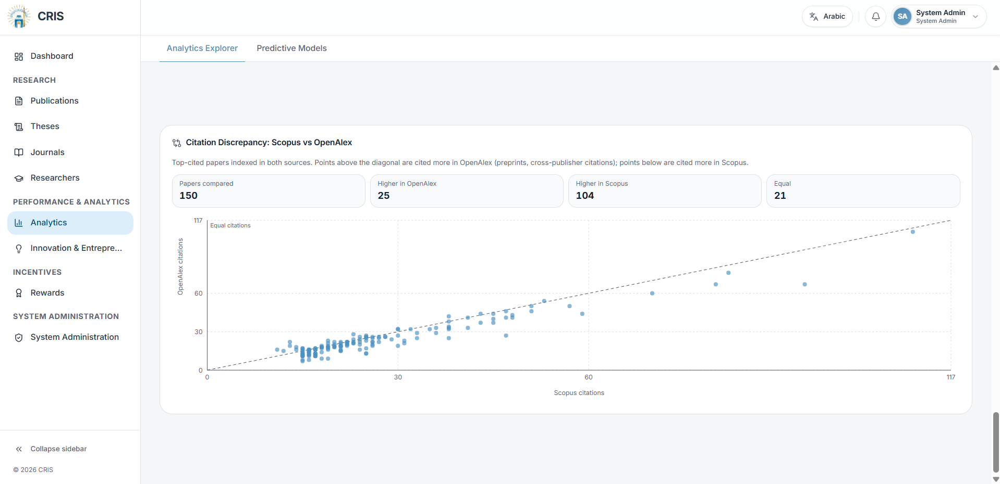
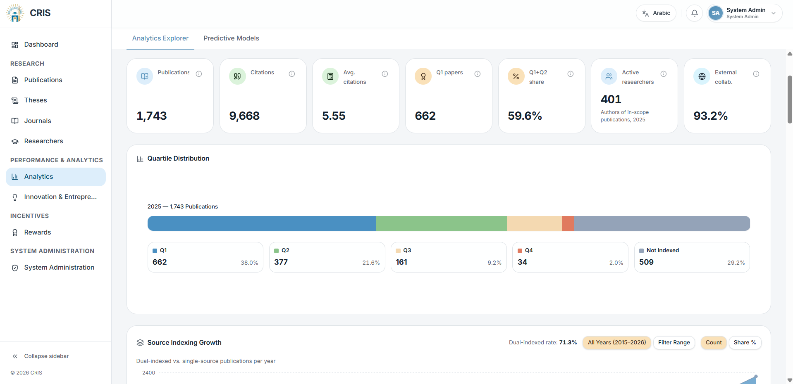

# Islamic University CRIS
### Comprehensive Research Information System & Institutional Intelligence Platform

[**Explore Live System**](https://iu-cris-system.vercel.app/) · [**The Problem**](#-the-core-problem--why-naive-systems-fail) · [**Architecture**](#-system-architecture) · [**ETL & Forensics**](#-multi-source-etl--identity-resolution) · [**Scalability**](#-engineered-for-seamless-scalability) · [**Showcase**](#-live-platform-showcase)

> [!IMPORTANT]
> **Repository Scope & Confidentiality**  
> This repository hosts the complete architectural documentation, engineering blueprints, and system showcase for our Computer Science graduation capstone (**CRIS**) built for the **Islamic University of Madinah**. In adherence to institutional data governance and server credential policies, proprietary source files and database seeds remain private, while the live deployment is accessible at **[https://iu-cris-system.vercel.app/](https://iu-cris-system.vercel.app/)**.

---

## Where Does a University's Research Actually Live?

At the Islamic University of Madinah, research lived in several places at once: international bibliographic databases and disconnected internal platforms, each holding its own records, often reconciled by hand. The same paper could appear twice or disappear completely, co-authorship across faculties was ambiguous, post-publication incentive claims had to be re-verified manually over and over, and executive leadership had no unified picture of university performance.

**CRIS (Current Research Information System)** turns that fragmentation into a single, verifiable, database-enforced source of truth spanning **7,359 publications**, **71,567 citations**, **1,375 researchers**, **49,654 global journals**, **graduate theses**, **startup ventures**, and **multi-stage financial rewards**—delivered through a bilingual (**Arabic RTL / English LTR**) SSR platform with **8 database-enforced security roles**.

---

## 1. The Core Problem — Why Naive Systems Fail

If you simply pull an external API into a React table, your numbers will be **wrong**—sometimes catastrophically wrong. When unifying real bibliometric data across **Elsevier Scopus**, **Clarivate Web of Science (WoS)**, **OpenAlex**, and Arabic **ARCIF** catalogs, we encountered **six hidden real-world failure modes** and engineered deterministic database-level solutions for each:

### Deep Dive into Every Problem We Solved

<b>Problem 1 &amp; 2: Phantom Institutions &amp; Preprint Double-Counting (Open to inspect exact logic)</b>

1. **The "Islamic University" Gaza Misattribution Trap:**  
   OpenAlex indexed the bare Arabic string `"الجامعة الإسلامية"` as an alias of Islamic University of Madinah (`I4210151290`). As a result, papers published by authors from the **Islamic University of Gaza (`I181086730`, DOI prefix `10.33976/iugj...`)** who omitted their city name were automatically credited to Madinah—creating phantom papers and ghost faculty accounts.  
   **Our Fix:** A multi-hop forensic quarantine inside PostgreSQL combining DOI prefix matching (`10.33976/`), co-occurring translated records without DOIs, and lateral JSON affiliation scanning that verifies zero Madinah/Saudi tokens exist before non-destructively setting `verification_status = 'rejected'`, resetting external author rows (`is_iu = false`), and keeping an explicit rollback trail.

2. **Preprints Masquerading as Separate Publications:**  
   Researchers upload preprints (`arXiv`, `SSRN`, `TechRxiv`, `OSF`, `Zenodo`, `ResearchSquare`) months before publishing the final peer-reviewed journal article under a completely different DOI.  
   **Our Fix:** Our deduplication pass normalizes titles (`> 25` alphanumeric characters) within a 2-year window across preprint DOI regex namespaces: whenever a non-preprint journal version exists, preprint mirrors are non-destructively excluded with provenance links (`kept_id`, `kept_doi`) rather than inflated in institutional counts.

<b>Problem 3 &amp; 4: Why Sources Disagree &amp; Why Historical Quartiles Must Be Immutable</b>

1. **Citation Counts Never Agree Across Databases:**  
   In an empirical audit of the **150 highest-cited papers indexed in both Scopus and OpenAlex**, only **21 papers (14.0%)** had identical citation counts (**104** counted higher in Scopus; **25** counted higher in OpenAlex due to preprints and cross-publisher links). Overwriting one source with another destroys audit truth.  
   **Our Fix:** Every publication preserves a multi-source provenance array (`sources metric_source[]`) alongside per-source rows in `publication_metrics`, allowing side-by-side trend comparison and a live Discrepancy Explorer.

2. **Protecting Past Faculty Rewards During Live API Syncs:**  
   A journal ranked **Q1 in 2023** may drop to **Q2 in 2026**. If a live Scopus sync updates `journals.citescore` globally and overwrites paper standings, researchers lose legal eligibility for historical awards—or fail compliance audits.  
   **Our Fix:** CRIS enforces strict **Temporal Metric Governance**: reward engines evaluate the journal's frozen historical metric year (`metric_year = publication_year`), while live API syncs refresh separate monitoring fields (`current_citescore_quartile`, `current_sjr_quartile`, `last_metrics_sync_at`).

<b>Problem 5 &amp; 6: Identity Splitting ("Arshad Ali x12") &amp; Arabic/Sharia Neglect</b>

1. **Fragmented Faculty Profiles Without False Auto-Merges:**  
   A single scholar often publishes under inconsistent Latin spellings (`Imran Shakir` vs. `Imran Shakyr`, `Ali Al-Zahrani` vs. `Aly Alzahrany`), or common names collide (`"Arshad Ali"` appeared across **12 separate OpenAlex author IDs**—and two distinct researchers named *Arshad Ali* co-authored the same paper!). Blind auto-merging corrupts authorship permanently.  
   **Our Fix:** A reversible, explainable admin review engine (`researcher_duplicate_candidates`) powered by PostgreSQL `_researcher_name_norm()` (folding Arabic `أإآ -> ا`, `ة -> ه`, `ى -> ي`, unifying `y -> i` transliteration, and splitting attached `al-/el-` prefixes) plus an auditable rollback snapshot table (`researcher_merge_history`).

2. **Serving Arabic, Sharia, Hadith &amp; Quran Colleges Fairly:**  
   Conventional bibliometric tools treat English STEM journals as the default and fail Arabic humanities colleges. We built `normalize_arabic_text()` and `classify_journal_major_fields()` natively in SQL—stripping Arabic diacritics (*Tashkeel*/*Tatweel*) and definite articles, isolating STEM keywords from *Fiqh/Sharia/Usul/Tafsir/Linguistics* terms across **49,654 journals**, and integrating **ARCIF** coverage.

---

## 2. System Architecture

CRIS uses a **Zero-Trust Database-Governed SSR Architecture**. Critical invariants—role scopes, salary-linked reward calculations, deduplication transactions, Arabic journal classification, and statistical forecasting—execute inside hardened **PostgreSQL `SECURITY DEFINER` RPCs and Row-Level Security (RLS) policies**, while the **React 19 + TanStack Start + Nitro** server/client layer orchestrates streaming SSR, optimistic queries, and bilingual RTL/LTR rendering.

### 8-Role Database Security Topology

Rather than relying on hide/show UI flags, every page and RPC enforces hierarchical and domain isolation directly inside PostgreSQL:

- Cross-scope tampering attempts (e.g., a `CollegeDean` querying a department outside their own college) are **blocked at the RPC boundary** and recorded automatically in `public.audit_log` as `security_violation` events.

---

## 3. Multi-Source ETL & Identity Resolution

Our ingestion pipeline treats external APIs as **untrusted, conflicting witnesses** rather than absolute truth:

---

## 4. Hierarchical Predictive Forecasting Engine

To eliminate impossible spikes and cover **all 13 colleges and 29 academic departments** without arbitrary `< 30` exclusion cutoffs, `train_forecast_models()` executes a 4-stage statistical pipeline directly in PostgreSQL:

- **Why not divide YTD output linearly by `day_of_year / 365`?** Institutional papers cluster heavily toward November–December, and missing publication months default to `January 1` in external feeds. Filtering `Jan 1` artifacts and measuring true 5-year historical Day-of-Year progression prevents early-year under-prediction and late-year distortion.

---

## 5. Global Journal Discovery & Arabic/Sharia Intelligence

How does a university catalog **49,654 global journals** so both an AI researcher seeking IEEE Transactions and an Islamic Jurisprudence scholar seeking an Arabic **ARCIF** venue get instant, accurate matches?

---

## 6. Zero-Trust Incentive Engine & Multi-Stage Review

Reward claims involve real financial disbursement. `incentive_quote()` and `incentive_submit()` enforce **100% server-authoritative computation**: client inputs for salary, nationality, quartile, author count, or payout amount are rejected by design.

---

## 7. Engineered for Seamless Scalability

CRIS was architected from day one so new faculties, bibliographic vendors, regulatory policies, and institutional centers plug in cleanly without rewriting core schemas or breaking historical records:

1. **Single-Source Navigation & Code Splitting (`src/layouts/navConfig.ts`):** Module groups, tabs, permissions, and document titles derive from one typed configuration synced with file-based route splitting via TanStack Router (`src/routeTree.gen.ts`).
2. **Non-Disruptive Domain Expansion:** When the **Innovation & Entrepreneurship Center**, **Quarterly Startup Tracking**, and **Graduate Theses** domains were introduced late in development (`migrations 0061–0063`), adding the 8th role (`Entrepreneurship`) reused shared SQL validation primitives (`_cris_fail`, `_cris_v_*`) without touching core publication or reward code.
3. **Pluggable Multi-Source & Quartile Architecture:** Bibliographic keys and sync health are decoupled behind `source_api_keys` and isolated staging tables, while KPI queries parameterize the metric framework (`SCImago SJR`, `Scopus CiteScore`, `WoS JCR`)—allowing seamless activation of Clarivate Web of Science and ARCIF streams.
4. **Immutable Versioned JSON Policies (`incentive_policies`):** Reward formulas live as versioned `jsonb` policies linked by `policy_id` on every claim alongside `[from_year, to_year]` journal designation bounds—zero code redeploys when university bylaws evolve.
5. **Corpus-Scale Database Performance:** `pg_trgm` and GIN array indexes handle 49,654 journals interactively, `MATERIALIZED` CTE analytics isolate heavy multi-chart aggregations, and `forecast_cache` eliminates runtime regression overhead.

---

## 8. Live Platform Showcase

### 1) Executive Overview — 7,359 Publications & 71,567 Citations
Unified KPIs, historical growth curves across `All Series` / `University Total` / `OpenAlex` / `Scopus`, historical quartile rings, and bilingual toggle (`Arabic` / English).

---

### 2) Citation Discrepancy Audit — Scopus vs. OpenAlex (150 Top Works)
Revealing why multi-source provenance beats overwriting records: only **21 papers match equally** across both indexes (**104** higher in Scopus; **25** higher in OpenAlex).

---

### 3) Analytics Explorer & Faculty Breakdown
Scoped institutional velocity (`1,743` papers, `9,668` citations, `59.6%` Q1+Q2 share, `93.2%` external collaboration, `71.3%` dual-indexed rate in the 2025 benchmark) and multi-college stacked comparisons with `Chart | Table | Both`, `Count | Share %`, and CSV export.

---

### 4) Empirical Bayes Predictive Model (`R² = 0.98`)
10-year damped log-linear forecast projecting **2,642** publications for end-of-2026 (from **2,314** YTD) and **3,546** in 2027 at **41% annual growth**, hierarchically reconciled across all colleges and departments.

---

### 5) Scientific Journal Catalog & Manuscript Smart Matcher (49,654 Journals)
Paste any Arabic or English working abstract or title to discover optimal venues filtered by `CS`, `SJR`, `JIF`, quartile (`Q1–Q4`), Open Access, prior IU publishing track record, or `Arabic & Theoretical Colleges`.

---

### 6) Zero-Trust Incentive & Reward Submission Wizard
3-step guided application computing salary-percentage **Excellence** or fixed-SAR **Post-Publication** quotes on the server from verified HR facts, ASJC subject alignment, and compliance evidence.

---

## Technology Stack

| Layer | Technologies & Engineering Role |
| :--- | :--- |
| **SSR & Routing Framework** | React 19.2, TanStack Start, TanStack Router, Nitro, Vite 7, TypeScript 5.8 |
| **State & Validation** | TanStack React Query v5, React Hook Form, Zod, Shared SQL `<area>:<field>:<rule>` Error Contracts |
| **UI & Visualization** | Tailwind CSS v4, Radix UI Primitives, Recharts (Area, Trend, Scatter, Stacked Quartiles), AR RTL / EN LTR |
| **Database & Business Core** | Supabase / PostgreSQL (118+ SQL Migrations), `SECURITY DEFINER` RPCs, 8-Role RLS, `pg_trgm` & GIN Indexes |
| **Scholarly Integrations** | Elsevier Scopus APIs, OpenAlex API, Clarivate Web of Science (WoS), SCImago SJR, ARCIF |
| **Testing & Automation** | Unit test suites (`navConfig`, journal relevance, duplicate matching, validation), SQL test harnesses (`test_incentive_engine.sql`), GitHub Actions keep-alive pipeline |

---

## Acknowledgments & Credits

Whatever merit this work has, after God, belongs to our supervisor, **Prof. Dr. Ali bin Mousa Gharmallah Alzahrani**, Vice President for Graduate Studies and Scientific Research, and to our academic and technical advisor, **Dr. Oussama Benrhouma** — our sincere thanks to both for their mentorship, trust, and guidance throughout this project.

Deep appreciation also goes to every companion and teammate on our Computer Science graduation capstone team at the Islamic University of Madinah for sharing this engineering journey from first API experiments to production deployment.

**Author & Engineering Contact:**  
**Abdulqader Alshihabi** — Software & AI Engineer · Computer Science (Class of 2027)  
- Live Platform: [https://iu-cris-system.vercel.app/](https://iu-cris-system.vercel.app/)  
- Portfolio: [https://abdulqader-alshihabi.github.io/](https://abdulqader-alshihabi.github.io/)  
- GitHub: [@Abdulqader-Alshihabi](https://github.com/Abdulqader-Alshihabi)  
- Email: [abdulqader.moh.2003@gmail.com](mailto:abdulqader.moh.2003@gmail.com)
